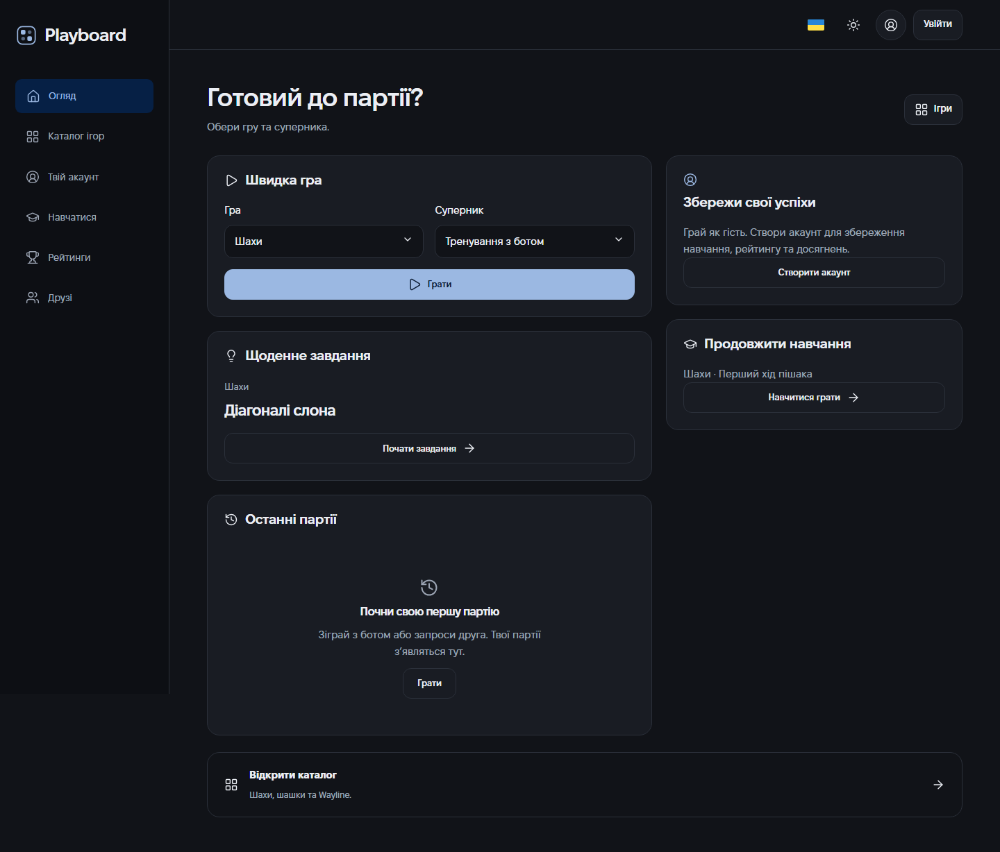
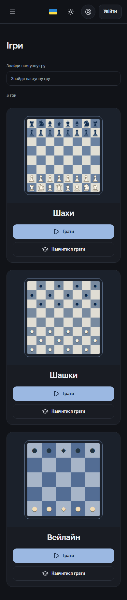

# Playboard

[English](README.md) · [Українська](README.uk.md)

[](https://github.com/andrew-berezovskyi/playboard/actions/workflows/check.yml)

A responsive strategy game platform with **Chess**, **Draughts-64**, and **Wayline**, an original card-driven tactical game. Built with a real Node.js server and PostgreSQL, with Ukrainian and English interfaces, locally hosted Fixel fonts, and a minimal dark/light design.

**Live beta: [playboard-rc19.onrender.com](https://playboard-rc19.onrender.com).** Hosted on Render Free with Neon PostgreSQL and Brevo email. The first visit after inactivity can take about a minute while the server wakes up. Remaining release requirements are listed below; this repository does not claim full FIDE/IDF tournament certification.

## Features

- Three independent engines with server-validated moves, three bot difficulties in workers, private invitations, human matchmaking, casual/ranked games and server clocks.
- Reconnection and persisted match state, mutually accepted rematches, move history/replay, chess PGN/FEN and JSON exports for the other games.
- Automatic guests, registration, email confirmation/reset, Argon2id passwords, HttpOnly sessions, profile editing/privacy and account deletion. Guest rooms transfer when creating a new account.
- 24 interactive tasks arranged into three step-by-step courses, contextual explanations, saved account progress, daily challenges and guided bot games with legal-move hints. Competitive games do not expose these hints.
- Separate Glicko-2 pools and rating histories; XP, levels, monthly leagues, timezone-aware streaks, activity calendars and achievements.
- Friends, blocks, consent-based online status, invitations, notifications and shared match history.
- Responsive Grid/Flex layouts and explicit media queries, touch/drag/keyboard controls, board/piece styles, card grids, capture effects, sound preferences and reduced motion.
- Same-browser account linking and repeat-pair reward limits. These reduce farming but do not detect every alternate account or engine-assisted player.

## Stack and structure

React 19, TypeScript, Vite, React Router, i18next; CSS Grid/Flex/media queries. Fastify, Socket.IO, Zod, Drizzle, PostgreSQL, Argon2id. Vitest, Playwright and axe.

- `apps/web` — pages, board interfaces, localization and styles.
- `apps/server` — authentication, matches, worker bots, learning, progress and SQL migrations.
- `packages/games` — independent rule engines, legal actions and replay.
- `packages/shared` — contracts, lessons/courses and Glicko-2.
- `scripts` — database setup, migration, seed, backup/restore, maintenance and publication scanning.
- `tests` — unit, real-database integration and browser scenarios.

## Local setup on Windows

Install Node.js 24 LTS. In PowerShell:

```powershell
npm ci
Copy-Item .env.example .env
```

Choose one database option: `docker compose up -d` with Docker Desktop, or `npm run db:local` for embedded PostgreSQL. Keep the embedded database terminal open. In another terminal:

```powershell
npm run db:migrate
npm run db:seed  # optional local demo account
npm run dev
```

Open [localhost:5173](http://localhost:5173). API: port 3001; PostgreSQL: port 54329. Optional demo: `demo@plyvra.local` / `LocalDemoOnly!2026`. Seed is restricted to local development and never runs automatically.

Emails are written to ignored `.local/mail` files by default. Open the verification/reset link from the latest file. For Mailpit use `MAIL_TRANSPORT=smtp` and open [localhost:8025](http://localhost:8025). This local delivery is separate from production email.

Environment variables are documented in [.env.example](.env.example). `DATABASE_URL` is server-only. `WEB_ORIGIN` sets email links; `ALLOWED_ORIGINS` accepts exact origins. Production requires HTTPS, private database credentials and authenticated SMTP or Brevo HTTPS email. Never put secrets into `VITE_*` variables.

### Multiplayer and phone testing

Create a private room and open its invitation in another browser profile or incognito window. Each profile has its own player identity. For a phone on the same Wi-Fi, add Vite's exact Network URL to `ALLOWED_ORIGINS` and restart the API. The frontend proxies requests to the PC, so the phone does not connect to its own localhost. Allow access only on a private network; do not forward development ports to the internet.

## Checks and database operations

```powershell
npm run check
npx playwright install chromium firefox webkit
npm run test:e2e
npm run licenses
npm run db:maintenance                 # dry run
npm run db:maintenance -- --apply       # delete expired ephemeral records
```

Integration tests use a separate `plyvra_test` database. Browser tests create local fixtures. The suite runs sequentially and waits between groups to respect production rate limits.

For backup/restore, install PostgreSQL clients of a compatible major version and set `PG_BIN` to their bin directory if they are not on PATH:

```powershell
npm run db:backup
npm run db:verify-backup
npm run db:restore -- --file=.local/backups/example.dump --confirm-overwrite
```

**Restore replaces the configured database contents.** Verification creates and removes its own isolated local test database. Dumps, credentials and mail are ignored by Git. Store backups securely and test recovery before any public launch.

`npm run build` creates `dist/web` and `dist/server`. With `SERVE_WEB=true`, `npm start` serves the frontend, API and Socket.IO from one origin; otherwise it starts the API only. [Render deployment](docs/DEPLOYMENT.md) covers Neon, HTTPS email delivery and provider quotas.

## Interface





Screenshots show the running application. Generated raster artwork is not shipped with the frontend.

## Verification and remaining work

Local verification: 69 unit/integration tests, TypeScript, ESLint and production builds pass. Browser checks cover all 24 course exercises, three games, reconnects, keyboard/touch controls and 684 layout states across both languages and themes. Automated checks and browser emulation do not replace physical-device or manual accessibility audits.

Remaining: arbitrary rare chess dead-position adjudication beyond the implemented material/pawn-wall proofs; the IDF immediate small-material draw exception (the documented online variant uses move counters); long-term Wayline balance, comprehensive abuse detection, physical iPhone/Android checks and manual accessibility review. HTTPS, verified database TLS and registration email delivery are checked on the live beta. Production proxy/client-IP validation, storage caps and operational backup scheduling remain open; password-reset inbox delivery still needs a separate check. Optional PWA, OAuth, chat and Stockfish are not implemented.

## Documentation and licenses

[Architecture](docs/ARCHITECTURE.md) · [Database](docs/DATABASE.md) · [API](docs/API.md) · [Rules](docs/GAME_RULES.md) · [Security](docs/SECURITY.md) · [Deployment](docs/DEPLOYMENT.md) · [Licenses](docs/LICENSES.md)

Fixel is distributed under SIL OFL; its license is retained. No Onitama publisher artwork is included. No project-wide license has been granted yet; dependency licenses remain applicable. The intended hosting budget is 0 USD within free quotas, not unlimited capacity or guaranteed uptime. There are no payments or automatic paid upgrades.
