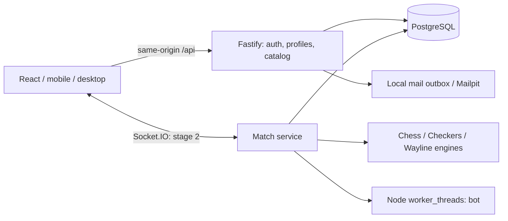

# Архітектура Playboard

Модульний моноліт для трьох стратегічних ігор. Функціональний обсяг і відомі обмеження beta описано в README.md; правила ігор — у GAME_RULES.md.

## Бренд і дизайн

Playboard — назва, обрана користувачем. Fixel з офіційного MacPaw-джерела зберігається локально у WOFF2, ліцензія SIL OFL включена. Графітова основа з Navy Blue #062045, спокійні поверхні, власний мінімалістичний знак дошки. Згенерованих картинок у frontend немає. Технічні Plyvra cookie/storage/database identifiers збережені для сумісності.

CSS Grid/Flexbox і медіазапити дають 1/2/3 колонки; ігрова дошка масштабована, на телефоні панель партії переходить під неї. Tap, drag, клавіатура, reduced-motion, вимикання звуку й анімації. Локальні шрифти Fixel, графітова/navy та світла теми, спільні Radix-меню й Lucide-іконки.

## Модульний моноліт

- React + TypeScript strict + Vite + React Router + i18next; Context тільки для сесії/мови/теми. TanStack Query додати при складніших серверних кешах, не зараз.
- Fastify + Zod + REST. Fastify вибраний за інкапсуляцію плагінів, lifecycle hooks і inject для інтеграційних тестів.
- PostgreSQL + Drizzle; SQL-міграції транзакційні, версійовані, параметризовані запити. Один процес backend на початку, без Redis.
- Socket.IO у шаховому етапі. Engines і контракти не залежать від Fastify/Socket.IO/БД; транспорт можна замінити.
- npm scripts, Vitest, Playwright, ESLint, Prettier; Docker Compose PostgreSQL/Mailpit. Локальний embedded PostgreSQL — реальний PostgreSQL для Windows без Docker, тільки development.

apps/web — presentation; apps/server — auth, database, HTTP; packages/shared — Zod contracts, catalog, GameEngine; scripts — local services; tests — real DB integration and browser flows. Інші доменні модулі створюються після вертикального зрізу, не як порожні шаблони.

## Серверна авторитетність і майбутні матчі

Команда: matchId, actionId, expectedVersion, payload. Сервер перевіряє сесію/учасника/чергу/схему/допустимість; транзакційно блокує рядок матчу, звіряє версію, додає подію з unique(matchId, actionId), оновлює snapshot і clock deadline. Commit перед broadcast. Повтор повертає попередній результат. Повторне підключення отримує snapshot + version, не довіряє клієнтській історії. Завершення матчу, рейтинг та XP — одна транзакція з унікальним ключем зарахування. Clock зберігає remainingMs і turnStartedAt; після рестарту deadline відновлюється. Рейтингові ігри не живуть лише в пам'яті.

Гості: випадкові серверні ідентичності для нерейтингових приватних/online/bot матчів і навчання. Рейтинг: Glicko-2 окремо за game/rules/time-pool; матчі з ботом виключені. Matchmaking розширює rating window з часом, без прихованих ботів. При втраті зв'язку — явний стан, reconnect, серверна політика grace period. Сезони, XP, streak та cosmetics відокремлені від рейтингу.

## Безпека

Argon2id; випадкові 256-bit токени, в БД лише SHA-256; HttpOnly SameSite=Lax cookies, Secure у production; нова сесія при login, видалення при logout/reset. CSRF: exact Origin allowlist + JSON-only write requests + custom header; SameSite — додатковий бар'єр. Rate limits, Zod, generic login/reset errors, logger redaction, CSP, власник ресурсів. Приватний email повертається тільки власнику /me. SMTP і паролі БД тільки на сервері. Деталі у SECURITY.md.

## Нульова вартість: рішення до backend

Основний майбутній профіль: Cloudflare Pages Free + Render Free Node + Supabase Free PostgreSQL. Не Render Free Postgres: він тимчасовий. Перевірено офіційні сторінки 11.10.2026: Render засинає після 15 хвилин без вхідного трафіку, 750 год/місяць; Supabase 500MB, 5GB egress, пауза після тижня неактивності. Постійні активні WebSocket/клієнтські події потребують реальної перевірки перед запуском; не обіцяємо uptime або необмежені матчі. SMTP для публічного сайту — окремий невирішений ресурс, безкоштовна доступність має бути перевірена.

Альтернатива оцінена: Workers + SQLite Durable Objects + D1 доступні на Free, DO 100000 запитів/день та 13000 GB-s/день; D1 5M reads/100k writes на день, 5GB. Per-match DO із WebSocket hibernation зручний для серіалізації команд, але D1 не PostgreSQL, native Argon2/Node Socket.IO потребують іншого адаптера, CPU limits впливають на hashing/bots. Для першого етапу обираємо Node/PostgreSQL: відповідає ТЗ і краще локально тестується. Engine/transport/storage boundaries залишають міграцію можливою, але не безкоштовною за обсягом роботи.

Для cookies при різних доменах Pages/Render потрібен same-origin /api reverse proxy і WS-маршрут або власний домен; cross-site cookies не є надійною базою мобільної авторизації. Майбутній proxy — не реалізовано. Жодних тарифів, акаунтів або деплою зараз. Ліміти Free означають відмову в сервісі/пауза, а не автоматичний перехід на Paid. Перед публікацією ще раз перевірити умови.

Джерела: https://render.com/docs/free ; https://supabase.com/pricing ; https://developers.cloudflare.com/durable-objects/platform/pricing/ ; https://developers.cloudflare.com/d1/platform/pricing/ ; https://fastify.dev/docs/latest/ ; https://vite.dev/guide/ ; https://github.com/leinelissen/embedded-postgres .

## Ризики і критерії

Шахові draw claims не тотожні chess.js isDraw: 3-fold/50 moves — claim, 5-fold/75 — automatic; потрібно окремо тестувати. Shashki variant зафіксувати перед engine. Onitama trademark/assets не використовувати. Stockfish GPLv3: рішення щодо розповсюдження і source obligations перед інтеграцією. Безкоштовний хостинг не гарантує production SLA. Не виміряні Lighthouse/iPhone Safari не позначати перевіреними.
