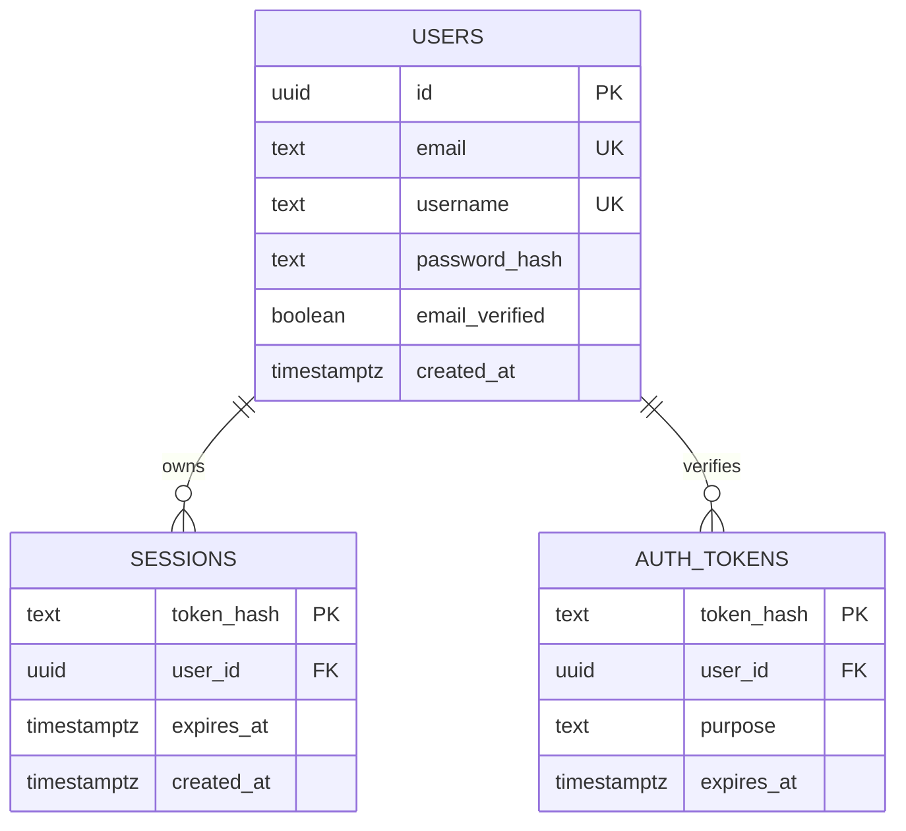

# Database design

Auth uses typed Drizzle declarations; match and platform services use parameterized pg transactions. Runtime PostgreSQL uses a five-connection pool. Migration runner takes a PostgreSQL advisory lock and records applied filenames. Never edit an applied migration: add a new file.

0004_platform.sql adds user_profiles, ratings, match_results, rating_history, experience, daily_activity, tutorial_progress, achievements, friendships, blocks, notifications, board_matches, board_participants, board_events and board_queue. Chess/board queues carry ranked flags. 0005_presence.sql adds consented last_seen. Personal tables cascade on account deletion; match seats become anonymous. Rating/result/reward uniqueness prevents duplicate finalization, with deterministic account lock ordering.

Username/email canonicalized to lowercase; unique constraints resolve simultaneous registrations. Sessions/tokens cascade on user deletion and index user/expiry. Expired rows are rejected on every read and cleaned hourly while the backend is running. Token consumption is DELETE RETURNING inside a transaction, making reuse impossible. Reset changes the hash and deletes all sessions/reset tokens in that transaction. UUID defaults use PostgreSQL gen_random_uuid. No profile stats are synthesized.

## Implemented platform data

Migrations 0002/0003 implement chess rooms, seats, event history, clocks, private invitations, queue and rematch consent. 0004 implements the analogous board-game storage plus profiles, separate rating pools/history, unique result and XP ledgers, tutorial progress, achievements, calendar activity, friend requests/accepted pairs, blocks and owned notifications. 0005 adds opted-in online presence.

Snapshots use JSONB; account relations, seats, events and progress stay normalized. Match finalization and derived rewards use one transaction. Personal tables cascade on account deletion; seat names and identities become anonymous. Guest tokens are random 256-bit cookie credentials, represented as hashes in seat identities.

Retention of abandoned rooms and completed histories still needs a production policy. Scripts and migrations are local; no production database exists.
Local demo seed is explicit, development-only and loopback-only. Tests use plyvra_test and delete only the rows they created. E2E currently creates clearly named e2e_* accounts in the local development DB. No production seed account is automatic.

## Implemented chess beta

Migrations 0002_chess.sql and 0003_rematch_consent.sql add matches, participants, events and the real-human queue. Chess uses parameterized pg transactions and row locks. See CHESS_IMPLEMENTATION.md for the actual fields, CAS/idempotency constraints and remaining retention work.

Міграція 0006 зберігає rules_version для шахів і board matches. Сервер відмовляє в ходах/читанні стану невідомої версії, щоб не переінтерпретовувати історію новими правилами. При реєстрації учасники гостьових кімнат поточного cookie атомарно переходять у новий акаунт; XP/рейтинги заднім числом не створюються.

Migration 0007_account_devices.sql stores user_id/device_hash/seen_at with an index for shared-browser checks. Raw tokens never enter the database; account deletion cascades links. See OPERATIONS.md for verified native backup/restore and retention tooling.
